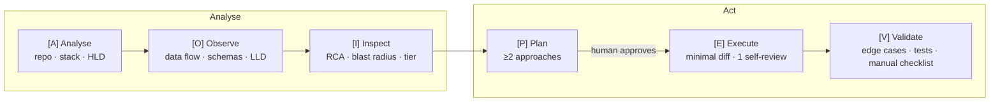

# Analyse-Act (AOI-PEV)

**Analyse before you act.** A staged software-engineering workflow for AI coding agents: understand the repo, find the real root cause, agree on a plan with a human, then make the smallest change that works and prove it.



| Stage | What it does | Output |
|---|---|---|
| **A**nalyse | Scans manifests, layout and docs | `.aa/context.md`: stack, module map, HLD diagram |
| **O**bserve | Traces entrypoints, models and data flow for the relevant area | `.aa/schema_cache.json` plus a sequence/ER diagram |
| **I**nspect | Root cause with `file:line` evidence, then blast radius and risk | RCA, Blast Radius Matrix, complexity tier |
| **P**lan | At least 2 approaches with tradeoffs; **stops for your approval** | Decision Matrix (reply `A` or `B`) |
| **E**xecute | Implements only the approved approach, with one self-review pass | Diff summary compared with the plan |
| **V**alidate | Requirements against evidence, edge cases, tests (1 retry) | Final card plus a manual verification checklist |

## Why

- **No jumping to solutions.** No code is written until the root cause is named and a human has picked an approach.
- **Small diffs by default.** Complexity tiers cap files and lines changed. Going past a cap requires your explicit OK.
- **Repo context is cached.** `.aa/` is keyed to the git commit. A repeat run on an unchanged repo skips re-scanning, and a run after a few changes rescans only those files.
- **No endless loops.** One self-review pass and one test-fix retry, then an honest handoff with a manual checklist.
- **Every stage is visible.** Each stage prints a banner and a short summary, using tables and Mermaid diagrams.

## Install

### Claude Code (plugin)

```
/plugin marketplace add AkashAgarwalInd/analyse-act-aoi-pev-agent
/plugin install analyse-act@analyse-act
```

Plugin skills are namespaced, so the command is **`/analyse-act:analyse-act`**. You can also just ask for it ("use analyse-act to fix …") and Claude will pick the skill up.

### Claude Code (manual)

```sh
git clone https://github.com/AkashAgarwalInd/analyse-act-aoi-pev-agent
cp -r analyse-act-aoi-pev-agent/skills/analyse-act ~/.claude/skills/
```

Installed this way, the command is `/analyse-act`.

### Codex

Copy [`adapters/codex/AGENTS.md`](adapters/codex/AGENTS.md) into your repo root. If you already have an `AGENTS.md`, append it. The workflow is opt-in: it runs only when you ask for "analyse-act" or "AOI-PEV".

### Cursor

Copy [`adapters/cursor/analyse-act.mdc`](adapters/cursor/analyse-act.mdc) to `.cursor/rules/`, then mention `@analyse-act` in chat.

### GitHub Copilot

Copy [`adapters/copilot/copilot-instructions.md`](adapters/copilot/copilot-instructions.md) to `.github/copilot-instructions.md` in your repo. If that file already exists, append it. Copilot loads these instructions on every request, but the workflow only runs when you ask for "analyse-act" or "AOI-PEV".

### Aider

Copy [`adapters/aider/CONVENTIONS.md`](adapters/aider/CONVENTIONS.md) into your repo and load it read-only, either with `aider --read CONVENTIONS.md` or by adding `read: CONVENTIONS.md` to `.aider.conf.yml`.

## Usage

The examples use the manual-install name; with the plugin, write `/analyse-act:analyse-act`.

```
/analyse-act "users get logged out a minute early"     # full run, stops at the plan gate
/analyse-act "why is checkout slow?" --analyse-only    # RCA and impact report only
/analyse-act "add CSV export" --tier L                 # force a tier
/analyse-act "..." --from P                            # resume from a stage
/analyse-act "..." --refresh                           # ignore the cache
/analyse-act "fix the typo in the README"              # trivial: fast path, one y/n gate
/analyse-act "..." --full                              # never take the fast path
/analyse-act "..." --branch                            # work on a new aa/<task-slug> branch
```

**Fast path.** A trivial change (one file, 5 lines or fewer, no behaviour change beyond the ask) skips the stages. You get the exact diff and reply `y` to apply it. Nothing is edited before you approve, on either path.

See a full sample run in [docs/examples/bug-fix-walkthrough.md](docs/examples/bug-fix-walkthrough.md).

## Complexity tiers

| Tier | Max files | Max net LOC | Token budget (guide) | Time (guide) | Notes |
|---|---|---|---|---|---|
| S | 2 | 50 | ~20k | ~5 min | small fixes |
| M | 3 | 150 | ~60k | ~15 min | default |
| L | 8 | 400 | ~150k | ~40 min | split into phases |

The tier is guessed right after the cache check and confirmed during **Inspect** with evidence. Caps are defaults: the plan flags any breach and you decide.

Budgets are **advisory**. The agent can't meter its own tokens exactly, so it estimates them and asks before continuing when a stage runs well over budget.

## The `.aa/` directory

Created in **your** repo, at its root.

| File | Purpose | Commit? |
|---|---|---|
| `context.md` | Stack, module map, HLD | Recommended, so the team shares context |
| `schema_cache.json` | Models, entrypoints, flows, test commands | Optional |
| `cache_meta.json` | The commit the cache reflects | With `context.md` |
| `dirty_at_scan.txt` | Files that had uncommitted edits when scanned; rescanned next run | With `cache_meta.json` |
| `current_session.json` | State of the current task, used for resuming | No. Add it to `.gitignore` |
| `sessions/` | Archived sessions from earlier tasks | No. Add it to `.gitignore` |

Cache status comes from [`aa-cache.sh`](skills/analyse-act/scripts/aa-cache.sh), which needs only POSIX `sh` and git. After a scan, `aa-cache.sh --stamp` writes `cache_meta.json` and `dirty_at_scan.txt`, so the hash and timestamp come from git and the clock, not from the model:
- **HIT**: nothing changed, so Analyse and Observe are skipped.
- **DELTA**: 5 or fewer files changed, so only those files are rescanned.
- **MISS**: a full scan runs.

JSON schemas are in [`skills/analyse-act/schemas/`](skills/analyse-act/schemas). The skill never writes secret values into `.aa/`, only names such as `DATABASE_URL`.

## Repo layout

```
.claude-plugin/          plugin + marketplace manifests
skills/analyse-act/
  SKILL.md               entry point (flow, gates, tiers, rules)
  references/            per-stage instructions, loaded only when that stage runs
  schemas/               JSON schemas for .aa/ files
  scripts/aa-cache.sh    cache status check (--stamp records a scan)
adapters/                Codex, Cursor, Copilot + Aider versions, generated from adapters/src/workflow.md
scripts/build-adapters.sh  regenerates adapters/ (CI fails on drift)
tests/                   cache-script tests, e2e smoke test, fixture repo
docs/examples/           sample walkthrough + sample .aa/ files
```

## Development

```sh
sh tests/aa-cache.test.sh     # cache script tests (fast, no LLM)
sh scripts/build-adapters.sh  # after editing adapters/src/workflow.md
sh tests/e2e-smoke.sh         # runs the real skill headlessly twice; costs tokens
```

## Roadmap

- **v2:** an optional headless runner (LangGraph state graph with `interrupt()` at the Plan gate) for CI and batch use.
- Measured token and latency comparisons with and without the cache.
- A `claude plugin eval` suite. This is blocked for now: the eval sandbox can't run git on macOS, and the skill needs it.

## License

MIT
