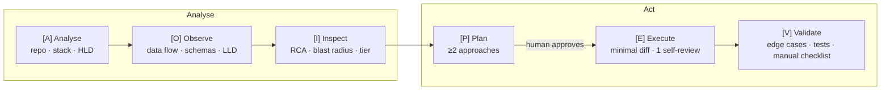
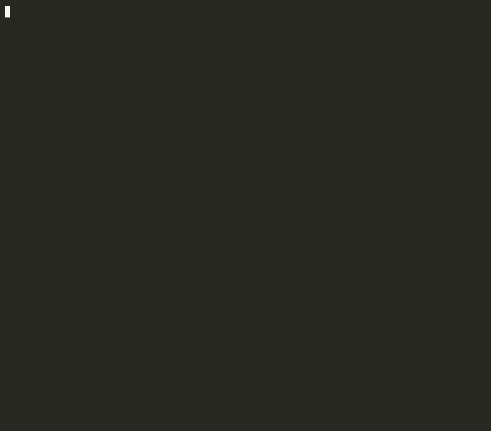

# Analyse-Act (AOI-PEV)

**Analyse before you act.** A staged software-engineering workflow for AI coding agents: understand the repo, find the real root cause, agree on a plan with a human, then make the smallest change that works and prove it.



| Stage | What it does | Output |
|---|---|---|
| **A**nalyse | Scans manifests, layout and docs | `.aa/context.md`: stack, module map, HLD diagram |
| **O**bserve | Traces entrypoints, models and data flow for the relevant area | `.aa/schema_cache.json` plus a sequence/ER diagram |
| **I**nspect | Root cause with `file:line` evidence, then blast radius and risk | RCA, Blast Radius Matrix, complexity tier |
| **P**lan | At least 2 approaches with tradeoffs; **stops for your approval** | Decision Matrix (reply `A` or `B`) |
| **E**xecute | Implements only the approved approach, with one self-review pass | Diff summary compared with the plan |
| **V**alidate | Requirements against evidence, edge cases, tests (1 retry) | Final card plus a manual verification checklist |

## Demo

**Clickable gates in Claude Code.** A real run on a tier-M task (add refresh tokens). At [P] you pick an approach in a picker that previews each one's files, LOC, risk and a code sketch. The run then goes straight on to [E] and [V], and `npm test` passes 7/7. Sped up about 4.5×; some redraw artifacts around the picker come from the recording, not from Claude Code. ([MP4](docs/demo/skill-clickable-gates.mp4))


**`aa-agent -i` in the terminal.** Choose an approach at [P], look at the diff at a drift pause with `d`, continue with `c`, and finish with `status=done`. The stage output comes from a stubbed model; the prompts, drift check and diff are the real CLI. ([MP4](docs/demo/aa-agent-interactive.mp4))



## Why

- **No jumping to solutions.** No code is written until the root cause is named and a human has picked an approach.
- **Small diffs by default.** Complexity tiers cap files and lines changed. Going past a cap requires your explicit OK.
- **Repo context is cached.** `.aa/` is keyed to the git commit. A repeat run on an unchanged repo skips re-scanning, and a run after a few changes rescans only those files.
- **No endless loops.** One self-review pass and one test-fix retry, then an honest handoff with a manual checklist.
- **Every stage is visible.** Each stage prints a banner and a short summary, using tables and Mermaid diagrams.

## Install

### Claude Code (plugin)

```
/plugin marketplace add AkashAgarwalInd/analyse-act-aoi-pev-agent
/plugin install analyse-act@analyse-act
```

Plugin skills are namespaced, so the command is **`/analyse-act:analyse-act`**. You can also just ask for it ("use analyse-act to fix …") and Claude will pick the skill up.

### Claude Code (manual)

```sh
git clone https://github.com/AkashAgarwalInd/analyse-act-aoi-pev-agent
cp -r analyse-act-aoi-pev-agent/skills/analyse-act ~/.claude/skills/
```

Installed this way, the command is `/analyse-act`.

### Codex

Copy [`adapters/codex/AGENTS.md`](adapters/codex/AGENTS.md) into your repo root. If you already have an `AGENTS.md`, append it. The workflow is opt-in: it runs only when you ask for "analyse-act" or "AOI-PEV".

### Cursor

Copy [`adapters/cursor/analyse-act.mdc`](adapters/cursor/analyse-act.mdc) to `.cursor/rules/`, then mention `@analyse-act` in chat.

### GitHub Copilot

Copy [`adapters/copilot/copilot-instructions.md`](adapters/copilot/copilot-instructions.md) to `.github/copilot-instructions.md` in your repo. If that file already exists, append it. Copilot loads these instructions on every request, but the workflow only runs when you ask for "analyse-act" or "AOI-PEV".

### Aider

Copy [`adapters/aider/CONVENTIONS.md`](adapters/aider/CONVENTIONS.md) into your repo and load it read-only, either with `aider --read CONVENTIONS.md` or by adding `read: CONVENTIONS.md` to `.aider.conf.yml`.

## Usage

The examples use the manual-install name; with the plugin, write `/analyse-act:analyse-act`.

```
/analyse-act "users get logged out a minute early"     # full run, stops at the plan gate
/analyse-act "why is checkout slow?" --analyse-only    # RCA and impact report only
/analyse-act "add CSV export" --tier L                 # force a tier
/analyse-act "..." --from P                            # resume from a stage
/analyse-act "..." --refresh                           # ignore the cache
/analyse-act "fix the typo in the README"              # trivial: fast path, one y/n gate
/analyse-act "..." --full                              # never take the fast path
/analyse-act "..." --branch                            # work on a new aa/<task-slug> branch
/analyse-act "..." --guided                            # also pause after [A], [O], [I] to review or add context
/analyse-act "fix the typo" --guided --full            # guided on a trivial task (it takes the fast path otherwise)
```

**Modes.** Approving the plan at [P] is required in every mode.

| Mode | How it runs | How to use it |
|---|---|---|
| Approval-gated (default) | [A], [O] and [I] run without stopping, reusing the cache; the run stops at [P] | `/analyse-act "<task>"` |
| Guided | Also stops after each analysis stage that ran ([A], [O], a DELTA rescan, [I]) so you can review it, add context or stop. Your context reaches every later stage, and is kept in `.aa/current_session.json` when you switch between the skill and `aa-agent`. A trivial task still takes the fast path unless you add `--full` | `--guided` (skill, `aa-agent`, and the CI example's `guided` input) |
| Headless / CI | Runs unattended and checkpoints; each pause suspends the run until a later `aa-agent resume` | `aa-agent run` (below) |

**Gates.** In Claude Code, the plan gate shows the approaches as clickable options, each with a preview of its files, LOC and risk. Pick "Other" to type changes to the plan. The fast-path, drift and budget gates are clickable too. Typing `A`, `y` or `continue` still works, and is what headless runs and the other editors use.

**Fast path.** A trivial change (one file, 5 lines or fewer, no behaviour change beyond the ask, never a dependency bump) skips the stages. You get the exact diff and reply `y` to apply it. Nothing is edited before you approve, on either path.

See a full sample run in [docs/examples/bug-fix-walkthrough.md](docs/examples/bug-fix-walkthrough.md).

## Headless / CI (LangGraph)

[`langgraph_agent/`](langgraph_agent) is a headless runner built on LangGraph. Its stage prompts are this skill's own reference files, which are bundled into the package. A run checkpoints after every stage to `.aa/agent.sqlite`, and the [P] gate is a LangGraph `interrupt()`, so the approval can come from a later CI job.

```sh
pip install "analyse-act-agent @ git+https://github.com/AkashAgarwalInd/analyse-act-aoi-pev-agent#subdirectory=langgraph_agent"
export ANTHROPIC_API_KEY=...
aa-agent run "users get logged out a minute early" --check "npm test" --plan-out plan.md   # stops at [P]
aa-agent resume --thread users-get-logged-out-a-minute-early --choice A  # [E] then [V]
aa-agent resume --thread users-get-logged-out-a-minute-early --choice A --edit "also cover refresh tokens"
aa-agent resume --thread users-get-logged-out-a-minute-early --decision continue  # after a budget/drift pause
aa-agent status --thread users-get-logged-out-a-minute-early
aa-agent run "users get logged out a minute early" --guided   # also pauses after [A], [O], [I]
aa-agent resume --thread users-get-logged-out-a-minute-early --note "the bug is in refresh"   # continue with context
aa-agent run --from-session   # continue at [P] from a session the interactive skill left there
aa-agent resume --thread users-get-logged-out-a-minute-early   # after a crash or Ctrl-C: retry the stage
```

**Interactive (local).** Add `-i` to `run` or `resume` to answer each pause in the terminal and keep going in the same process, with no separate `resume` commands:

```
$ aa-agent run "users get logged out a minute early" --check "npm test" -i
[A] Inline fix (Recommended)   files: src/auth/token.ts   ~6 LOC   risk Low
[B] Convert at middleware boundary   files: middleware/requireAuth.ts, src/auth/token.ts   ~25 LOC   risk Medium
Choose A/B (or 1-2), e to edit, q to quit [A]:
```

Enter picks the recommended approach, and `e` lets you edit it. Budget and drift pauses ask `[c]ontinue / [s]top / [q]uit`, and a guided stage pause adds `[n]ote` to continue with context for the later stages. A drift pause first lists each changed file with its LOC, and `d` shows the full diff, including new files. `q` (or Ctrl-D) leaves the thread paused and prints the `resume` command. The same checks apply as for `resume`, so a moved HEAD is still refused. `-i` turns itself off when stdin isn't a terminal or `CI` is set.

- The agent's file tools reject paths outside the repo and inside `.git/`. The model can only write under `.aa/` until [E]. Its git tool takes read-only subcommands, and only options from an allowlist, because options such as `--no-index` and `--contents` read files outside the repo.
- [E] and [V] can run **only** the commands you pass with `--check`, with no shell. The model may append test files or test names, but not options or paths outside the repo. The model writes `.aa/`, so a command recorded there is never trusted. Without `--check`, the checks are reported as manual.
- In `.aa/`, the model can write only `context.md`, `context.<package>.md` and `schema_cache.json`, and only before [E]. The checkpoint database, cache stamp and session files belong to the runner.
- The cache works as it does in the skill: HIT skips [A] and [O], DELTA rescans only the changed files (or does a full rescan if a manifest changed), and `--refresh` forces a full scan. The runner stamps the cache itself.
- `resume` refuses if HEAD has moved since the plan was made, or if the plan had no parseable approaches. In that case the run ends `handed_off`.
- **Pauses.** The runner enforces the skill's rules mechanically. Each stage's tokens are measured: what it read plus what it wrote, not the history re-sent on every call. A stage that runs more than 1.5× its tier budget pauses with `status=awaiting_budget_decision`. After [E], the diff is checked against the plan and the tier caps. The same check runs again after [V]'s auto-fix retry, but asks only about new problems. An unplanned file, a plan that lists no files, more than 1.5× the planned LOC, a cap breach the plan didn't flag, or `DRIFT` from the model pauses with `status=awaiting_drift_decision`. Files that already had uncommitted changes are measured from their state before [E]. Resume with `--decision continue` or `stop`.
- **Crashes.** The run checkpoints after every stage. If a stage crashes (an API error, Ctrl-C), `status` reports `status=interrupted`, and `aa-agent resume --thread <id>` with no other options re-runs that stage only. A crash during [E] or its fix retry is never retried, because the half-made edits would hide from the drift check. Check `git diff`, then finish with `/analyse-act --from E` or start a new run.
- **Sessions.** `.aa/current_session.json` is shared with the interactive skill. A headless run can be finished with `/analyse-act --from P`, and an interactive plan with `aa-agent run --from-session`.
- The runner never commits or pushes. `--branch` creates `aa/<task-slug>` before [E].
- [V] gets one auto-fix retry. If it still fails, the run ends with `status=handed_off` and exit code 1.
- [docs/examples/github-actions.yml](docs/examples/github-actions.yml) runs one dispatch per step: start with a task, then continue with a choice (plus an optional edit) or with a decision, as often as the run pauses. Each dispatch saves the checkpoint and the uncommitted edits for the next one. The diff is always uploaded as a patch.
- Add `.aa/agent.sqlite` to `.gitignore`.


| Tier | Max files | Max net LOC | Token budget (guide) | Time (guide) | Notes |
|---|---|---|---|---|---|
| S | 2 | 50 | ~20k | ~5 min | small fixes |
| M | 3 | 150 | ~60k | ~15 min | default |
| L | 8 | 400 | ~150k | ~40 min | split into phases |

The tier is guessed right after the cache check and confirmed during **Inspect** with evidence. Caps are defaults: the plan flags any breach and you decide.

Budgets are **advisory**. The agent can't meter its own tokens exactly, so it estimates them and asks before continuing when a stage runs well over budget.

## The `.aa/` directory

Created in **your** repo, at its root.

| File | Purpose | Commit? |
|---|---|---|
| `context.md` | Stack, module map, HLD | Recommended, so the team shares context |
| `schema_cache.json` | Models, entrypoints, flows, test commands | Optional |
| `cache_meta.json` | The commit the cache reflects | With `context.md` |
| `dirty_at_scan.txt` | Files that had uncommitted edits when scanned; rescanned next run | With `cache_meta.json` |
| `current_session.json` | State of the current task, used for resuming | No. Add it to `.gitignore` |
| `sessions/` | Archived sessions from earlier tasks | No. Add it to `.gitignore` |

Cache status comes from [`aa-cache.sh`](skills/analyse-act/scripts/aa-cache.sh), which needs only POSIX `sh` and git. After a scan, `aa-cache.sh --stamp` writes `cache_meta.json` and `dirty_at_scan.txt`, so the hash and timestamp come from git and the clock, not from the model:
- **HIT**: nothing changed, so Analyse and Observe are skipped.
- **DELTA**: 5 or fewer files changed, so only those files are rescanned.
- **MISS**: a full scan runs.

JSON schemas are in [`skills/analyse-act/schemas/`](skills/analyse-act/schemas). The skill never writes secret values into `.aa/`, only names such as `DATABASE_URL`.

## Repo layout

```
.claude-plugin/          plugin + marketplace manifests
skills/analyse-act/
  SKILL.md               entry point (flow, gates, tiers, rules)
  references/            per-stage instructions, loaded only when that stage runs
  schemas/               JSON schemas for .aa/ files
  scripts/aa-cache.sh    cache status check (--stamp records a scan)
adapters/                Codex, Cursor, Copilot + Aider versions, generated from adapters/src/workflow.md
scripts/build-adapters.sh  regenerates adapters/ (CI fails on drift)
tests/                   cache-script tests, e2e smoke test, fixture repo
langgraph_agent/         headless LangGraph runner (aa-agent CLI) for CI
docs/examples/           sample walkthrough, sample .aa/ files, GitHub Actions example
docs/demo/               demo recordings (GIF + MP4)
```

## Development

```sh
sh tests/aa-cache.test.sh     # cache script tests (fast, no LLM)
sh scripts/build-adapters.sh  # after editing adapters/src/workflow.md
sh tests/e2e-smoke.sh         # runs the real skill headlessly 3 times; costs tokens
(cd langgraph_agent && pip install -e '.[dev]' && ruff check . && pytest -q)  # runner tests, no LLM
```

## Roadmap

- Measured token and latency comparisons with and without the cache.
- A `claude plugin eval` suite. This is blocked for now: the eval sandbox can't run git on macOS, and the skill needs it.

## License

MIT
