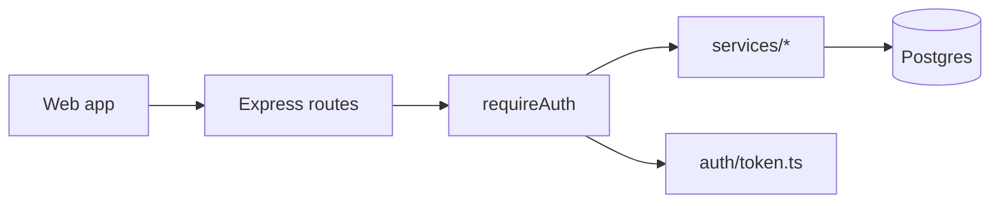
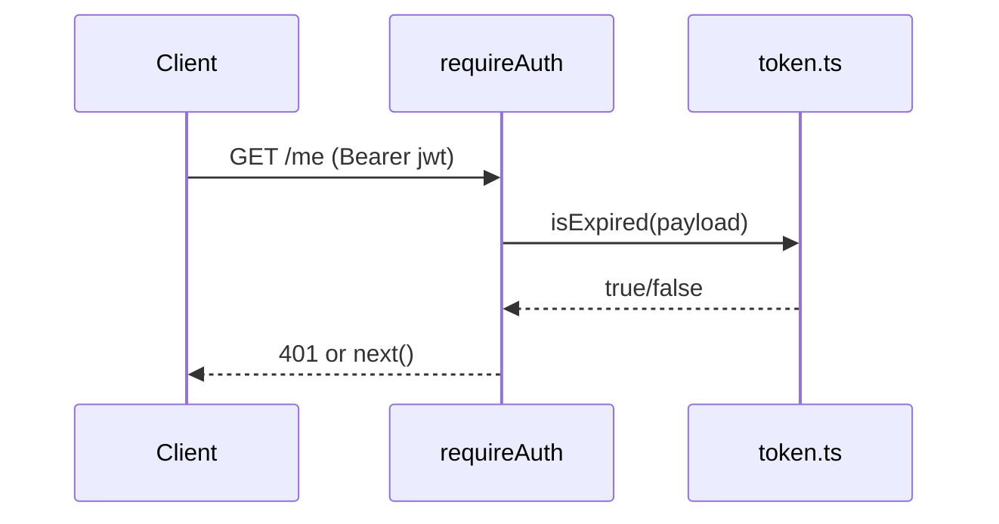

# Walkthrough — fixing a token-expiry bug with `/analyse-act`

Fictional Express + TypeScript API. Users report being logged out about a minute before their token expires.

```
/analyse-act "users get logged out about a minute before their session should expire"
```

---

### Stage 0 — cache

```
status=MISS
reason=no-cache
```

### [A] Analyse

```
━━ [A] ANALYSE · tier ? · cache MISS · budget ~8k tok ━━
```

| Area | Choice |
|---|---|
| Language | TypeScript 5 (Node 20) |
| Framework | Express 4 |
| Persistence | Postgres via Prisma |
| Tests | Vitest — `npm test` |
| Lint/Types | `npm run lint`, `npx tsc --noEmit` |



Stage summary: 4 modules; auth lives in `src/auth` + `src/middleware`. Wrote `.aa/context.md`. → next: [O]

### [O] Observe

```
━━ [O] OBSERVE · scope: src/auth, src/middleware ━━
```



`.aa/schema_cache.json` written (excerpt):

```json
{
  "data_models": [
    { "name": "Session", "file_path": "prisma/schema.prisma",
      "fields": { "id": "String", "userId": "String", "expiresAt": "DateTime" },
      "relationships": ["Session.userId -> User.id"] }
  ],
  "entrypoints": ["src/server.ts"],
  "data_flows": [
    { "feature": "authenticated request",
      "flow_sequence": ["routes/*", "middleware/requireAuth.ts", "auth/token.ts:isExpired"] }
  ],
  "tests": { "command": "npm test", "locations": ["src/auth/token.test.ts"] }
}
```

→ next: [I]

### [I] Inspect

```
━━ [I] INSPECT · tier M (pre-assessed S, raised — see below) · cache written ━━
Symptom:    sessions end ~60s before the token's exp
Hypotheses: (1) client clock ahead of server  (2) token issued with short exp  (3) expiry check off by a constant
Evidence:   (1) ✗ reproduces in a server-side unit test, no client involved
            (2) ✗ issued tokens carry the configured exp (auth/issue.ts:22)
            (3) ✓ src/auth/token.ts:18 — `return payload.exp - GRACE_SECONDS < nowSeconds()`
                git blame a1b2c3d "add 60s clock-skew grace": the grace was meant to
                *extend* validity (exp + 60) but was applied in the wrong direction
Root cause: clock-skew grace subtracted instead of added, so tokens expire 60s early
Confidence: High — failing unit test: exp = now + 30s → reported expired

Acceptance criteria:
- a token is valid until exp + 60s (the intended skew allowance) and expired after it
- existing expiry tests still pass

Blast radius
| Area                          | Type     | Risk   | Why                                              |
|-------------------------------|----------|--------|--------------------------------------------------|
| src/auth/token.ts:isExpired   | direct   | Low    | covered by token.test.ts                         |
| middleware/requireAuth.ts     | indirect | Medium | gates every protected route; integration tests only |
| jobs/sessionCleanup.ts        | indirect | High   | calls isExpired(), no tests — will now delete sessions 60s later |

Tier: M — the fix is one line, but the High-risk untested caller needs a test → 3 files (> S cap of 2)
```

### [P] Plan

```
━━ [P] PLAN · tier M · caps: ≤3 files, ≤150 LOC ━━

[A] Flip the sign: exp + GRACE_SECONDS < now  (Recommended)
    Files: src/auth/token.ts, src/auth/token.test.ts, jobs/sessionCleanup.test.ts (3)
    Diff: ~30 LOC   Risk: Low
    + fixes the root cause for every caller; keeps the intended skew tolerance
    + adds the missing test around sessionCleanup
    Perf: negligible

[B] Remove the grace window (expire exactly at exp)
    Files: src/auth/token.ts, src/auth/token.test.ts, jobs/sessionCleanup.test.ts (3)
    Diff: ~25 LOC   Risk: Medium
    + simplest expiry rule
    − brings back the clock-skew 401s that a1b2c3d was added to fix
    Perf: negligible

Tests planned: valid at exp+59s, expired at exp+61s; sessionCleanup keeps a session 30s past exp
Not doing: moving the grace value into config (no requirement for it)

Reply A or B (or edit the plan) to continue.
```

> **Human:** A

### [E] Execute

```
━━ [E] EXECUTE · approach A ━━
Changed: src/auth/token.ts (+1 −1), src/auth/token.test.ts (+14), jobs/sessionCleanup.test.ts (+19, new)
Plan vs actual: 3 files / ~30 LOC → 3 files / 34 LOC
Self-review: sessionCleanup test used real Date.now(); switched to the existing fake-clock helper. Nothing else found.
→ next: [V]
```

### [V] Validate

```
━━ [V] VALIDATE ━━
Requirements
  ✅ valid until exp + 60s       token.test.ts › "valid 59s after exp"
  ✅ expired after exp + 60s     token.test.ts › "expired 61s after exp"
  ✅ existing tests pass         npm test → 43 passed

Edge cases: ✅ exp = now  ✅ now = exp + 60s → still valid (strict <)  ✅ exp missing → expired
            ⬜ multi-server clock skew > 60s (out of scope)

Checks: npm test → 43 passed · npx tsc --noEmit → clean
Retry used: no

Manual Verification Checklist
  [ ] In staging, log in with a 5-min token; confirm the session survives past 5:00 and ends by ~6:00

Summary: 3 files, +34 −1. Root cause fixed at source. Not committed.
```

### Second run, later the same day (after the fix was committed)

```
status=DELTA
reason=3-files-changed
```

Only the 3 changed files are rescanned, so [A] and [O] are cheap. Once `cache_meta.json` is updated, the next run reports `status=HIT`.
