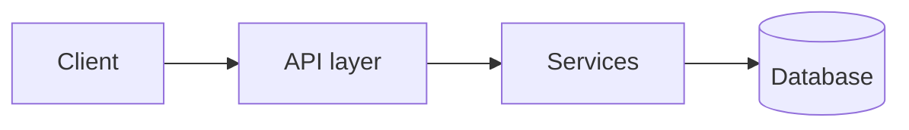

# [A] Analyse — repo context & HLD

**Objective:** a compact, reusable picture of the whole repo. Not the task — the repo.
**Budget:** 15% of the run budget (SKILL.md). Breadth over depth.

## Steps

1. **Manifests:** read whichever exist — `package.json`, `pyproject.toml`/`requirements*.txt`, `go.mod`, `Cargo.toml`, `pom.xml`/`build.gradle`, `Gemfile`, `composer.json`, `Dockerfile`, `docker-compose*.yml`, CI config (`.github/workflows/*`).
2. **Layout:** list top two directory levels (skip `node_modules`, `.venv`, `dist`, `build`, `vendor`, `.git`).
3. **Existing docs:** skim `README*`, `CLAUDE.md`, `AGENTS.md`, `CONTRIBUTING*`, `docs/` index, ADRs. Reuse — don't re-derive what they already say.
4. **Identify:** languages, frameworks, persistence (DB driver/ORM, cache, queues), external services, entrypoints (main, server, CLI, handlers), test framework + command, lint/format/typecheck commands.
5. **Module map:** one line per top-level module: purpose and key files.
6. **HLD:** one Mermaid diagram of major components and how they talk.

Do **not** read every source file. Open a file only when the manifest/layout leaves a component's role unclear.

**Monorepos** (workspaces, `packages/*`, `apps/*`, multiple manifests): keep `context.md` to the repo-level overview — one row per package in the module map. Write a per-package file `.aa/context.<package>.md` (same template) only for packages the task touches, and add new ones on demand in later runs.

**Secrets:** record env var / config *names* only, never values.

## Output — write `.aa/context.md`

~~~markdown
# Repo context — <name>
_commit: <short hash> · generated: <date>_

## Tech stack
| Area | Choice |
|---|---|
| Language | … |
| Framework | … |
| Persistence | … |
| Tests | <framework> — `<command>` |
| Lint/Types | `<command>` |

## Module map
| Path | Purpose | Key files |
|---|---|---|

## HLD

## Conventions & gotchas
- <naming/error-handling/config patterns worth matching>
~~~

Show the user the Tech stack table and HLD diagram in chat (not the whole file). Then → [O].
