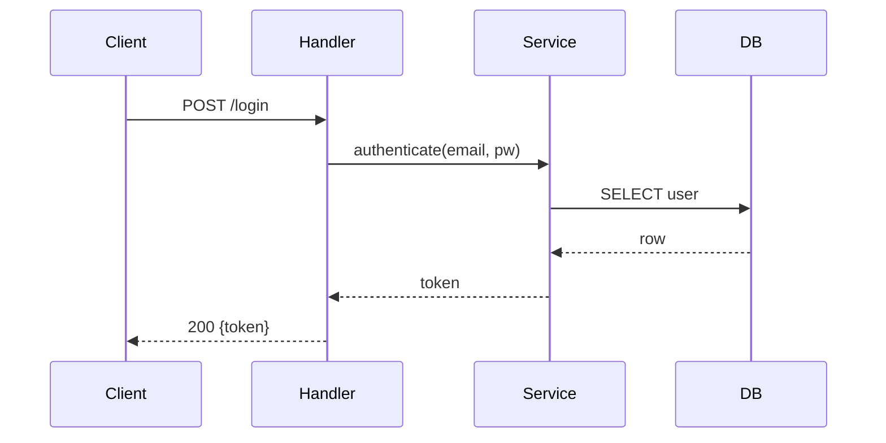

# [O] Observe — data flow, schemas, LLD

**Objective:** understand how data moves through the parts of the repo **relevant to the task**, plus durable facts worth caching.
**Budget:** 20% of the run budget. Tier S may skip this stage if `schema_cache.json` already covers the affected area.

## Steps

1. **Scope:** from the task + `context.md`, pick the modules involved. Say which ones and why in one line.
2. **Entrypoints:** routes/handlers/CLI commands/jobs that reach the area.
3. **Data models:** ORM models, DB schemas/migrations, DTOs, API types, protobuf/GraphQL schemas. Record fields that matter and relationships.
4. **Flow:** trace one request/event end-to-end: entry → validation → business logic → persistence → response/side effects. Note where state changes.
5. **Tests:** where tests for this area live, how they're run, what fixtures/mocks exist. List the existing test cases that exercise the traced flow (file › test name) and the obvious gaps — [I] uses these to rate risk and [V] to pick targeted tests.

## Output

1. Merge into `.aa/schema_cache.json` (validate against `schemas/schema_cache.schema.json`). Add/replace entries for observed models and flows — don't drop unrelated cached entries.
2. In chat, show **one** diagram for the relevant area — whichever explains it best:

or an `erDiagram` for entity relationships, or a `flowchart` for state transitions.

3. Write/refresh `.aa/cache_meta.json` (see `caching.md`). Then → [I].
